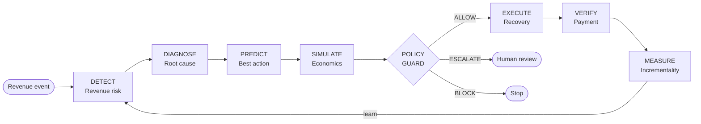
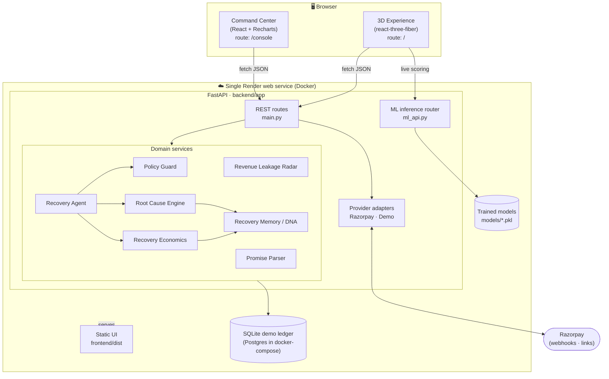
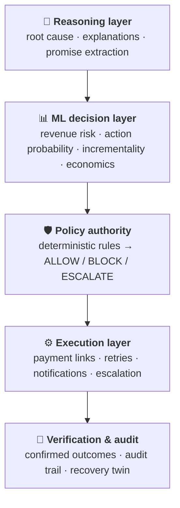
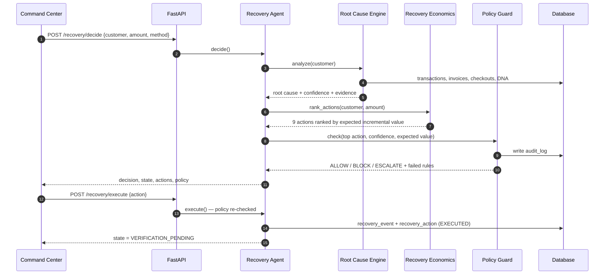
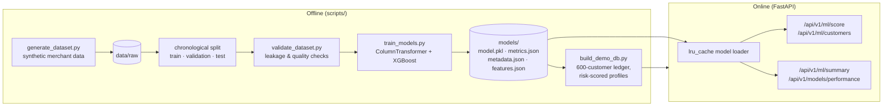
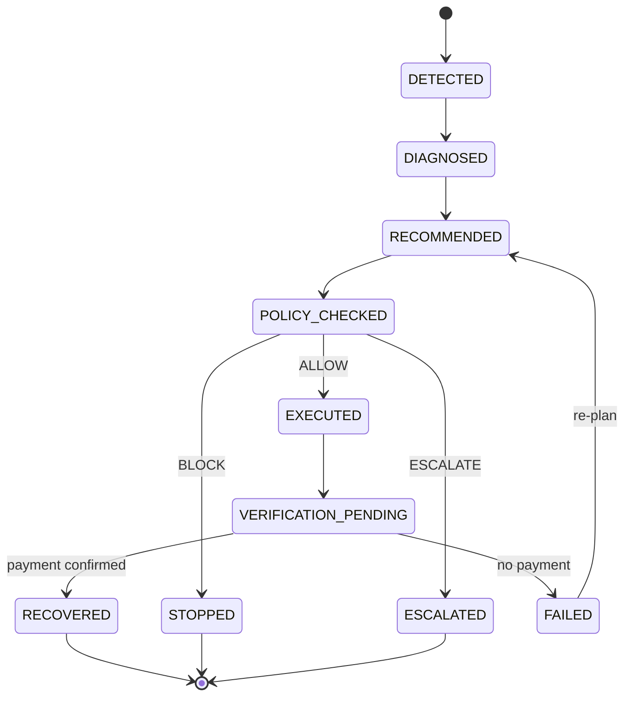
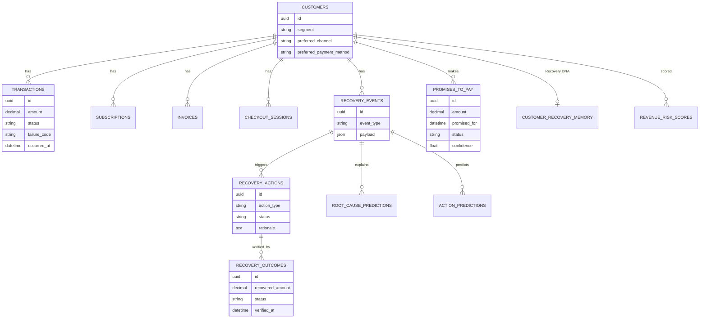
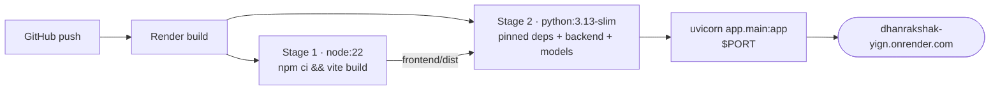

<div align="center">

# ₹ DhanRakshak

### Every rupee deserves a second chance.

**An AI-powered Revenue Recovery Control Plane.** DhanRakshak finds revenue that is at risk, works out why, predicts which recovery action will bring in the most *incremental* money, and only acts inside deterministic financial guardrails.

[**🌐 Live demo**](https://dhanrakshak-yign.onrender.com) · [Command Center](https://dhanrakshak-yign.onrender.com/console) · [API docs](https://dhanrakshak-yign.onrender.com/docs)


[](LICENSE)

</div>

> ⏳ The demo runs on Render's free plan. It sleeps after ~15 idle minutes, so the first visit can take 30–50 seconds to wake up.

---

## 📑 Table of contents

1. [The problem](#-the-problem)
2. [How DhanRakshak works](#-how-dhanrakshak-works)
3. [System architecture](#️-system-architecture)
4. [Core modules](#-core-modules)
5. [Machine learning](#-machine-learning)
6. [Frontend: 3D experience & Command Center](#-frontend-3d-experience--command-center)
7. [API reference](#-api-reference)
8. [Data model](#️-data-model)
9. [Tech stack](#️-tech-stack)
10. [Project structure](#-project-structure)
11. [Getting started](#-getting-started)
12. [Deployment](#-deployment)
13. [Testing](#-testing)
14. [Roadmap](#-roadmap)
15. [License](#-license)
16. [Disclaimer](#️-disclaimer)

---

## 🧭 The problem

Revenue doesn't only disappear when a payment fails. It leaks through abandoned checkouts, past-due subscriptions, ageing invoices, broken promises to pay, payment-method degradation, over-contacted customers, and discounts given to people who would have paid anyway.

| Traditional recovery | DhanRakshak |
|---|---|
| Payment failed → retry → retry → reminder → hope | Why did it fail? How risky is it? What has worked for *this* customer? |
| Optimises the number of attempts | Optimises **incremental** revenue minus cost and friction |
| Takes credit for every recovered payment | Separates organic from assisted recovery with a control group |
| Automation decides and acts | **Policy Guard** has the final say; every decision is audited |

> **AI recommends. Models quantify. Policy controls. Backend executes. Verification confirms. Audit records.**

---

## 🔁 How DhanRakshak works



| Step | What happens | Where in the code |
|---|---|---|
| Detect | Rolling-baseline radar over transactions, checkouts, invoices, subscriptions, promises | `services/revenue_leakage_radar.py` |
| Diagnose | Evidence-based root cause (liquidity, method mismatch, friction, fatigue…) | `services/root_cause_engine.py` |
| Predict | Recovery probability for 9 interventions | `ml_api.py`, `models/action_recovery` |
| Simulate | Expected value net of intervention cost, friction and organic recovery | `services/recovery_economics.py` |
| Govern | Deterministic rules → `ALLOW` / `BLOCK` / `ESCALATE`, written to the audit log | `services/policy_guard.py` |
| Execute | Bounded agent records the action and moves to `VERIFICATION_PENDING` | `services/recovery_agent.py`, `adapters/` |
| Verify & measure | Only confirmed payments count; recovery twin compares against control | `main.py` (`/recovery-twin`), `models/incrementality` |

---

## 🏗️ System architecture

### High-level architecture



### Layered responsibility

DhanRakshak deliberately separates **intelligence** from **financial authority**:



No layer can skip the one below it: the agent cannot execute a financial action without a Policy Guard decision, and recovered revenue is only counted after verification.

### Recovery decision sequence

What happens on `POST /api/v1/recovery/decide` and `/execute`:



### ML training & serving pipeline



### Recovery state machine



---

## 🧩 Core modules

### 🔎 Revenue Leakage Radar
Compares the current 30-day window against the previous one and turns signals into ranked opportunities with risk score, amount, confidence, root-cause candidate, time-to-intervene and recommended action.

Signals: payment degradation · payment-method degradation · sudden customer behaviour change · checkout abandonment · invoice ageing · subscription deterioration · missed promises · recovery fatigue · revenue concentration.

### 👤 Customer Recovery DNA
A persisted, explainable profile per customer: payment success by method, channel success, recovery success by action, best recovery hour/day, average recovery time, promise reliability, opt-out rate and **recovery fatigue** (`LOW` / `MEDIUM` / `HIGH`).

### 🧩 Root Cause Engine
Scores competing explanations from stored evidence: `temporary_liquidity_issue`, `payment_method_mismatch`, `authentication_friction`, `bank_network_instability`, `checkout_friction`, `invoice_collection_delay`, `subscription_payment_method_deterioration`, `recovery_fatigue`. It returns a confidence, the evidence list and a recommended intervention.

### 💰 Recovery Economics
```text
Expected incremental value = Amount × P(recovery | action)
                           − Amount × P(recovery | do nothing)
                           − intervention cost − customer friction − risk penalty
```
Evaluated for: `retry`, `payment_link`, `whatsapp`, `email`, `sms`, `delayed_retry`, `promise_to_pay`, `human_escalation`, `no_action`.

### 🛡️ Policy Guard (default rules)

| Rule | Value |
|---|---|
| Max attempts | 3 |
| Max messages / 7 days | 2 |
| Max total recovery actions | 3 |
| Max discount | 10% |
| Human review above | ₹1,00,000 |
| Minimum model confidence | 0.65 |
| Minimum expected incremental recovery | ₹100 |
| Auto-stop on | success · opt-out · dispute · fraud signal |

Every check is written to `audit_logs` with rules evaluated, rules failed and reason.

### 💬 Promise-to-Pay
Turns commitments such as *"Monday ko ₹50,000 clear kar dunga"* into a structured promise (amount, date, language, confidence) with reminder tracking. Handles English, Hindi/Hinglish and Bengali cues.

### 🪞 Recovery Twin
Compares the control group (no intervention) against treatment to report organic recovery, assisted recovery, **incremental recovery** and recovery rates with and without DhanRakshak.

---

## 🤖 Machine learning

All three models share one feature pipeline (`app/ml/features.py`): `StandardScaler` on numeric features plus `OneHotEncoder` on categorical ones, feeding an **XGBoost** classifier (falls back to `HistGradientBoostingClassifier` if XGBoost is unavailable). Splits are **chronological**, so the models are tested on later data than they were trained on.

| Model | Question it answers | Target | Trained on |
|---|---|---|---|
| `revenue_risk` | Will this revenue be lost? | `eventually_unrecovered` | 62,240 train rows |
| `action_recovery` | Will *this action* recover it? | `recovered_given_action` (action is a feature) | 62,240 train rows |
| `incrementality` | Would it recover with no intervention? | organic recovery (control group only) | control-group rows |

**Features:** amount, lifetime value, historical payment success rate, historical recovery rate, retry count, days overdue, tenure, previous failed attempts, previous recovery actions, days since last payment, payment method, failure reason, subscription status, checkout stage, preferred channel, time of day, day of week, segment (+ action).

### Results (held-out test set, 132,477 rows)

| Metric | Revenue risk |
|---|---|
| ROC-AUC | 0.608 |
| PR-AUC | 0.602 |
| Precision @ top 5% | 70.3% |
| Precision @ top 10% | 67.6% |
| Brier score | 0.243 |

| Incrementality | Value |
|---|---|
| Control recovery rate | 35.4% |
| Treatment recovery rate | 53.0% |
| **Uplift** | **+17.6 pts** |

The per-action recovery model reaches a ROC-AUC of 0.59–0.62 across the nine actions. These are honest numbers on noisy synthetic data: the ranking signal (precision in the top decile) is where the value lies.

Retrain with `python scripts/train_models.py`. Artifacts are pinned to the library versions in `backend/requirements-deploy.txt`.

---

## 🎨 Frontend: 3D experience & Command Center

### `/` — Scrollable 3D experience
Built with **react-three-fiber**, **drei** and **three.js**, and lazy-loaded so the 3D code doesn't slow the first paint.

| Section | What it shows | Interaction |
|---|---|---|
| Shield | Faceted guardian shield with a vortex of gold coins | Moves with scroll and mouse |
| Live pulse | Revenue at risk, verified recovered, incremental, high-risk exposure, leak breakdown | Animated counters, tilt cards |
| The loop | The 8-step recovery loop | Scroll-reveal |
| **Risk galaxy** | 220 highest-exposure customers in 3D (LTV × open amount × predicted risk) | Orbit, zoom, hover, click → live model dossier |
| **Model lab** | 3D bars of recovery probability per action vs the do-nothing baseline | Sliders and chips call `/api/v1/ml/score` live |
| Recovery twin | With vs without DhanRakshak | Animated comparison |
| Models | Metrics read from the saved artifacts | — |

### `/console` — Command Center
Overview · Revenue Radar · Recovery Autopilot · Customers · Promises · Experiments · Audit Trail · AI Command Center · Integrations · Model Performance · Recovery Twin.

---

## 🔌 API reference

Interactive docs: [`/docs`](https://dhanrakshak-yign.onrender.com/docs)

| Method | Endpoint | Purpose |
|---|---|---|
| GET | `/health` | Liveness |
| **POST** | **`/api/v1/ml/score`** | Score any scenario with all three models; returns risk, ranked actions, policy decision |
| GET | `/api/v1/ml/customers?limit=` | Risk-scored customers |
| GET | `/api/v1/ml/customers/{id}` | Live model dossier for one customer |
| GET | `/api/v1/ml/summary` | Model versions and metrics |
| POST | `/api/v1/ml/risk` · `/ml/action-probabilities` · `/ml/incrementality` | Individual model endpoints |
| GET | `/api/v1/models/performance` | Raw metrics and metadata |
| GET | `/api/v1/revenue-at-risk` | Revenue Leakage Radar |
| GET | `/api/v1/revenue-recovered` | Verified recovered revenue |
| POST | `/api/v1/recovery-twin/simulate` | Organic vs assisted vs incremental |
| POST | `/api/v1/root-cause/analyze` | Root cause for a customer |
| GET | `/api/v1/customers` · `/customers/{id}` · `/customers/{id}/recovery-dna` | Customers and Recovery DNA |
| POST | `/api/v1/recovery/simulate` · `/decide` · `/execute` · `/stop` | Bounded recovery workflow |
| POST | `/api/v1/policy/check` | Policy Guard decision |
| GET/POST | `/api/v1/promises-to-pay` | Promise ledger and natural-language capture |
| GET/POST | `/api/v1/experiments` | Experiments |
| GET | `/api/v1/audit` | Audit trail |
| POST | `/api/v1/webhooks/razorpay` | Signed, idempotent Razorpay webhook |
| POST | `/api/v1/demo/reset` · `/demo/run` | Deterministic demo |

<details>
<summary>Example: score a scenario</summary>

```bash
curl -X POST https://dhanrakshak-yign.onrender.com/api/v1/ml/score \
  -H 'Content-Type: application/json' \
  -d '{"amount": 25000, "payment_method": "upi", "segment": "SMB", "days_overdue": 12}'
```

```json
{
  "risk": { "probability_unrecovered": 0.60, "tier": "medium", "model_version": "revenue_risk-v1" },
  "organic_recovery_probability": 0.29,
  "do_nothing_probability": 0.34,
  "recommended_action": "human_escalation",
  "policy_decision": "ALLOW",
  "actions": [{ "action": "human_escalation", "recovery_probability": 0.58, "expected_incremental_value": 5300.4 }, "..."],
  "explanation": "60% chance this ₹25,000 stays unrecovered. Doing nothing recovers 34% ..."
}
```
</details>

---

## 🗃️ Data model



Supporting tables: `audit_logs`, `policies`, `experiments`, `model_versions`, `webhook_events`, `notification_events`. Schema migrations live in `backend/alembic/`.

**Dataset:** `synthetic-benchmark-2026-v1`, made up of fictional merchants and customers (100k customers, 200k checkouts, 150k invoices, 100k subscriptions), split chronologically into `data/train`, `data/validation`, `data/test`.

---

## 🛠️ Tech stack

| Layer | Technology |
|---|---|
| Frontend | React 19, TypeScript, Vite, three.js, @react-three/fiber, @react-three/drei, Recharts, Framer Motion, lucide-react |
| Backend | FastAPI, Pydantic v2, SQLAlchemy 2, Alembic, Uvicorn |
| ML | XGBoost, scikit-learn pipelines, pandas, NumPy |
| Data | SQLite (demo / deploy), PostgreSQL 16 (docker-compose) |
| Payments | Razorpay adapter (signature verification, idempotent webhooks), demo adapter |
| Infra | Docker (multi-stage), Render (`render.yaml`), docker-compose for local full stack |

---

## 📁 Project structure

```text
DhanRakshak/
├── backend/
│   ├── app/
│   │   ├── main.py                 # REST routes + serves built UI
│   │   ├── ml_api.py               # live inference: /api/v1/ml/*
│   │   ├── models.py · schemas.py · db.py · config.py
│   │   ├── ml/                     # feature engineering + model wrappers
│   │   ├── services/               # radar, root cause, DNA, economics, policy, agent, promises
│   │   └── adapters/               # razorpay, demo
│   ├── alembic/                    # migrations
│   ├── tests/                      # pytest suite
│   ├── dhanrakshak.db              # seeded demo ledger (built by scripts/build_demo_db.py)
│   └── requirements*.txt
├── frontend/
│   └── src/
│       ├── experience/             # 3D experience: scenes, galaxy, model lab
│       ├── App.tsx                 # Command Center (/console)
│       └── main.tsx                # route switch
├── models/                         # trained artifacts + demo_customer_profiles.csv
├── data/                           # synthetic dataset (raw + chronological splits)
├── scripts/                        # generate · validate · train · seed · build_demo_db
├── tests/                          # dataset pipeline tests
├── docs/ARCHITECTURE.md
├── Dockerfile · render.yaml        # single-service deployment
└── docker-compose.yml              # local Postgres + API + UI
```

---

## 🚀 Getting started

**Prerequisites:** Python 3.13, Node 22.

```bash
git clone https://github.com/oindreela04/DhanRakshak.git && cd DhanRakshak

# 1. Backend dependencies
pip install -r backend/requirements-deploy.txt

# 2. (Optional) retrain models and rebuild the demo ledger
python scripts/train_models.py --data-root data --output-root models
python scripts/build_demo_db.py

# 3. Build the UI
cd frontend && npm ci && npm run build && cd ..

# 4. Run — UI and API on one port
cd backend && uvicorn app.main:app --port 8000
# → http://localhost:8000  (3D experience)
# → http://localhost:8000/console  (Command Center)
# → http://localhost:8000/docs  (API docs)
```

**Frontend dev mode** (hot reload, talks to the API on :8000): `cd frontend && npm run dev`

**Full stack with Postgres:** `docker compose up --build`

Configuration (`.env`, see `.env.example`): `DATABASE_URL`, `RAZORPAY_KEY_ID`, `RAZORPAY_KEY_SECRET`, `RAZORPAY_WEBHOOK_SECRET`, `LLM_API_KEY`, `LLM_PROVIDER`, `ENVIRONMENT`.

---

## ☁️ Deployment



- One Docker image serves the UI, the API and the models; no CORS or second service needed.
- `render.yaml` declares the service (Docker runtime, free plan, `/health` check).
- Auto-deploys on every push to the configured branch.
- The demo SQLite ledger is baked into the image. Runtime writes (policy checks, promises) reset on each redeploy.

---

## 🧪 Testing

```bash
cd backend && pytest -q     # API, services, radar, root cause, DNA, webhooks
cd .. && pytest -q tests    # dataset pipeline
```

---

## 🔭 Roadmap

- [ ] LLM reasoning layer for explanations and multilingual message drafting (config hooks already exist)
- [ ] Live Razorpay payment-link execution and outcome verification via webhooks
- [ ] Persistent Postgres in production plus scheduled radar runs
- [ ] Contextual-bandit action selection learning from verified outcomes
- [ ] Per-merchant policy editor in the Command Center
- [ ] WhatsApp / SMS provider adapters

---

## 📄 License

Released under the [MIT License](LICENSE). © 2026 Oindreela Saha.

---

## ⚠️ Disclaimer

All data in this repository and on the live demo is **synthetic**. Customers, merchants and amounts are fictional. The Razorpay integration runs in test mode. DhanRakshak is a research and demo project, not financial advice or a production collections system.

<div align="center">

**DhanRakshak** — *recover more, add less friction, explain everything.*

</div>
